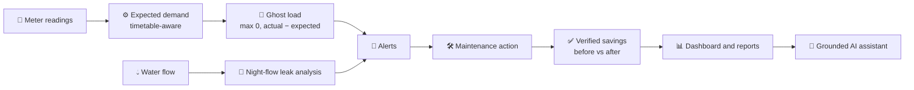

<!-- ===================== HEADER ===================== -->
<div align="center">


<a href="https://github.com/Ankit-Tank/Eco-Campus">
  
</a>

<br/>


<br/>

**[✨ Features](#-features) · [📸 Screenshots](#-screenshots) · [🧠 How It Works](#-how-it-works) · [🛠️ Tech Stack](#️-tech-stack) · [🚀 Quick Start](#-quick-start) · [📚 Docs](#-documentation)**

</div>

<br/>

<div align="center">
  
</div>

---

## 🌍 About

**Eco-Campus** is an intelligent campus sustainability platform. It helps administrators **monitor electricity and water usage**, **detect ghost loads** (power drawn by rooms that should be idle), **verify the savings** that follow corrective action, and **run maintenance workflows**, all in one place. Students can report wastage they spot and see the impact of their reports. A **grounded AI assistant** answers questions using real campus data, not guesses.

> 🟢 **Monitor** &nbsp;·&nbsp; 🔵 **Understand** &nbsp;·&nbsp; 🟡 **Reduce** &nbsp;·&nbsp; 🟣 **Together**

> 💡 **Note:** The screenshots show seeded demo data, marked with a *Simulated data* badge in the app.

---

## ✨ Features

| | Feature | What it does |
|---|---|---|
| 👻 | **Ghost Load Detection** | Compares actual load with a timetable-aware expected demand model to find wasted power in empty rooms |
| ✅ | **Verified Savings** | Measures real savings by comparing consumption before and after an action |
| 💧 | **Water Leak Detection** | Uses night-flow analysis to spot leaks, tracks tank levels per block and raises alerts |
| 🔔 | **Smart Alerts** | Severity-based alerts that admins can *Acknowledge* or *Resolve* |
| 🛠️ | **Maintenance Tracking** | Tickets with priority, reporter and status, from *Submitted* to *Resolved* |
| 📊 | **Reports & CSV Export** | Energy, Water, Savings and Maintenance reports for any date range |
| 🧑‍🎓 | **Student Reporting** | Students report wastage, track each report's status and see their environmental impact |
| 🤖 | **Grounded AI Assistant** | Groq-powered chatbot that answers only from approved backend data tools, with a deterministic offline fallback |
| 🏆 | **Block Leaderboard** | Ranks campus blocks by sustainability performance |
| 🎛️ | **Live Simulator** | Virtual-time demo engine that injects readings for live walkthroughs |
| 🌐 | **Bilingual UI** | Switch between **English** and **हिन्दी** in one click |
| 🔐 | **Role-Based Access** | Separate Admin and Student experiences with JWT auth |

---

## 📸 Screenshots

### 🛡️ Admin Dashboard

<table>
  <tr>
    <td width="50%" align="center">
      <br/>
      <b>📈 Overview</b><br/>
      <sub>Consumption, CO₂ and money saved, plus actual vs estimated load</sub>
    </td>
    <td width="50%" align="center">
      <br/>
      <b>⚡ Electricity</b><br/>
      <sub>Visual telemetry and the usage breakdown by type</sub>
    </td>
  </tr>
  <tr>
    <td width="50%" align="center">
      <br/>
      <b>💧 Water</b><br/>
      <sub>Daily use against target, tank levels and open leaks</sub>
    </td>
    <td width="50%" align="center">
      <br/>
      <b>🔔 Alerts</b><br/>
      <sub>Ghost loads and leaks, ready to acknowledge or resolve</sub>
    </td>
  </tr>
  <tr>
    <td width="50%" align="center">
      <br/>
      <b>🛠️ Maintenance</b><br/>
      <sub>Tickets with priority, reporter and a status workflow</sub>
    </td>
    <td width="50%" align="center">
      <br/>
      <b>📄 Reports</b><br/>
      <sub>Preview any period and download it as CSV</sub>
    </td>
  </tr>
</table>

### 🧑‍🎓 Student Portal

<table>
  <tr>
    <td width="50%" align="center">
      <br/>
      <b>🏠 Home</b><br/>
      <sub>Report a new issue and follow your recent reports</sub>
    </td>
    <td width="50%" align="center">
      <br/>
      <b>🤖 AI Chatbot</b><br/>
      <sub>Ask about campus energy, water and your reports</sub>
    </td>
  </tr>
  <tr>
    <td colspan="2" align="center">
      <br/>
      <b>🇮🇳 हिन्दी Support</b><br/>
      <sub>The full interface switches to Hindi instantly</sub>
    </td>
  </tr>
</table>

---

## 🧠 How It Works



**Ghost load** is calculated as `max(0, actual − expected)`. The expected value comes from each room's timetable, capacity and equipment ratings, so a classroom that is lit and cooled during a lecture is *not* flagged, but the same room running at midnight is.

---

## 🛠️ Tech Stack

<div align="center">

| Layer | Technologies |
|---|---|
| **Backend** | Python · FastAPI · Uvicorn · SQLAlchemy · SQLite |
| **Auth** | JWT (`python-jose`) · password hashing (`passlib` + bcrypt) |
| **Data** | Pandas · NumPy |
| **AI** | Groq API (server-side only) with tool calling |
| **Frontend** | React 18 · Vite · React Router · Recharts · Lucide Icons |
| **Styling & i18n** | Plain CSS · English / Hindi language resources |
| **Testing** | pytest |

</div>

---

## 📁 Project Structure

```text
Eco-Campus/
├── backend/
│   ├── app/
│   │   ├── core/        # config, security, dependencies
│   │   ├── db/          # engine + ORM models
│   │   ├── routes/      # API routes by domain
│   │   ├── schemas/     # request/response models
│   │   └── services/    # business logic and analytics
│   ├── scripts/         # seed script
│   ├── tests/           # backend test suite
│   └── requirements.txt
├── frontend/
│   ├── src/
│   │   ├── pages/       # admin and student pages
│   │   ├── services/    # API clients + mock services
│   │   ├── components/  # reusable UI blocks
│   │   ├── auth/        # route guards and session helpers
│   │   └── i18n/        # English / Hindi resources
│   └── package.json
├── docs/
│   ├── screenshots/     # images used in this README
│   ├── API.md
│   ├── ARCHITECTURE.md
│   ├── DEMO_SCRIPT.md
│   └── SPEC.md
└── README.md
```

---

## 🚀 Quick Start

### ⚡ Option A: Frontend only (fastest)

No backend needed. The UI runs on built-in mock data.

```bash
cd frontend
npm install
cp .env.example .env      # keep VITE_USE_MOCK=true
npm run dev
```

Open **http://localhost:5173** 🎉

### 🔧 Option B: Full stack

**1️⃣ Backend**

```bash
cd backend
python -m venv .venv
source .venv/bin/activate        # Windows: .venv\Scripts\Activate.ps1
pip install -r requirements.txt
cp .env.example .env             # add your GROQ_API_KEY for the AI assistant
python -m scripts.seed
uvicorn app.main:app --reload --port 8000
```

| Service | URL |
|---|---|
| API | http://localhost:8000 |
| Swagger UI | http://localhost:8000/docs |
| ReDoc | http://localhost:8000/redoc |

**2️⃣ Frontend**

```bash
cd frontend
npm install
cp .env.example .env
# set VITE_USE_MOCK=false in .env to talk to the backend
npm run dev
```

### 🎚️ Frontend run modes

| Variable | Value | Effect |
|---|---|---|
| `VITE_USE_MOCK` | `true` | UI runs on mock data only |
| `VITE_USE_MOCK` | `false` | Calls the FastAPI backend through the `/api` proxy |
| `VITE_DEMO_MODE` | `true` | Pre-fills demo logins and shows the OTP hint |

> 🤖 **AI assistant:** without a `GROQ_API_KEY`, or if the API times out, the backend automatically falls back to a deterministic rule engine that uses the same approved data tools.

---

## 🔑 Demo Accounts

**Mock mode** (`VITE_USE_MOCK=true`)

| Role | Login |
|---|---|
| 🧑‍🎓 User | Mobile `9876543210` + OTP `123456` |
| 🛡️ Admin | `admin@ecocampus.demo` / `admin123` |

**Seeded backend** (`VITE_USE_MOCK=false`)

| Role | Email | Password |
|---|---|---|
| 🛡️ Admin | `admin@ghostwatt.demo` | `admin123` |
| 🧑‍🎓 Student | `student@ghostwatt.demo` | `student123` |

> ⚠️ These are demo credentials for local use only. Never use them in production.

---

## 🧩 Core Backend Domains

| Domain | Responsibility |
|---|---|
| `auth` | Login, profile and token handling |
| `dashboard` | Sustainability summary and KPI endpoints |
| `electricity` · `ghost_load` | Consumption and anomaly intelligence |
| `water` | Leak analysis and alerts |
| `reports` · `complaints` | Reporting workflows |
| `actions` · `savings` | Switch-off actions and savings verification |
| `simulator` · `live` | Virtual-time demo orchestration |
| `assistant` | Grounded assistant APIs |
| `leaderboard` | Block-level sustainability ranking |

---

## 🧪 Testing

```bash
cd backend
pytest -v
```

The suite covers ghost load, expected demand and carbon calculation, water analysis, savings verification, the simulator, assistant behaviour and role permissions.

---

## 📚 Documentation

| 📖 Document | Description |
|---|---|
| [Architecture](docs/ARCHITECTURE.md) | System design, data flow and folder layout |
| [API Reference](docs/API.md) | Endpoint documentation |
| [Specification](docs/SPEC.md) | Full system specification |
| [Demo Script](docs/DEMO_SCRIPT.md) | Step-by-step walkthrough for presentations |
| [Libraries](LIBRARIES.md) | Dependencies and AI model inventory |

---

## 👥 Contributors

<a href="https://github.com/Ankit-Tank/Eco-Campus/graphs/contributors">
  
</a>

Built with 💚 by [**Krishna**](https://github.com/Ankit-Tank) and team.

---

## 📄 License

Distributed under the **MIT License**. See [`LICENSE`](LICENSE) for details.

---

<div align="center">

### 🌱 If Eco-Campus inspires you, drop a ⭐ and help make campuses greener!


</div>
